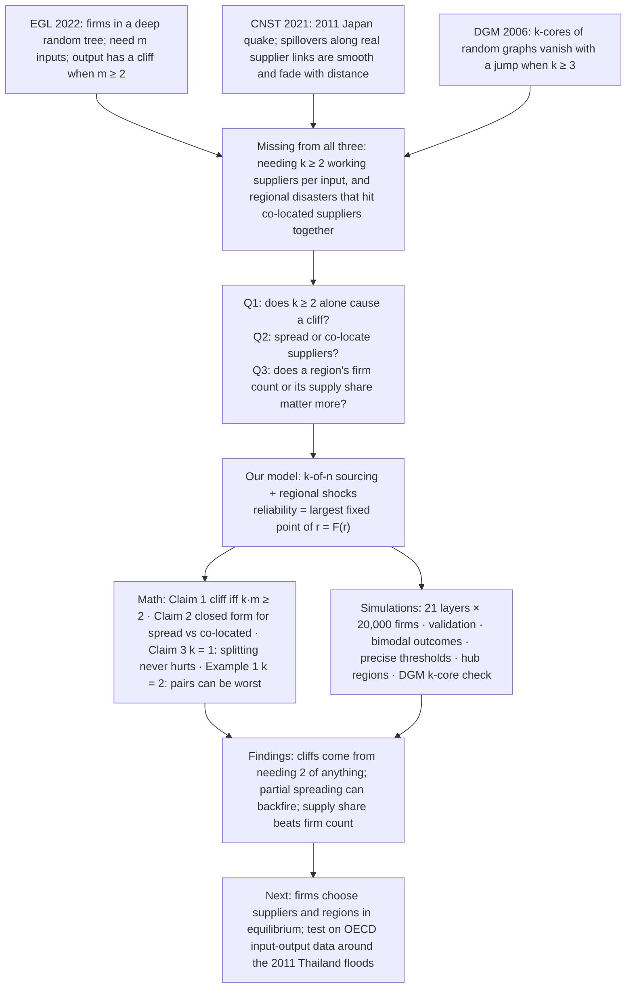
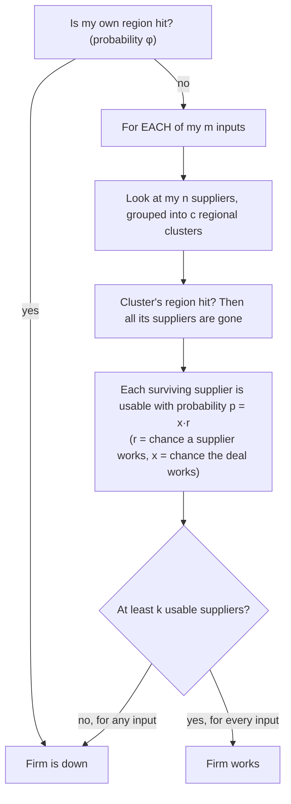
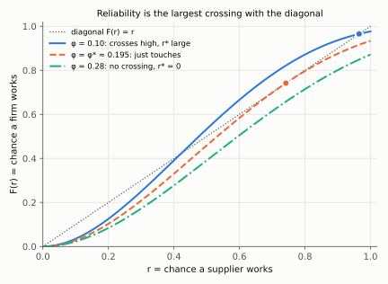
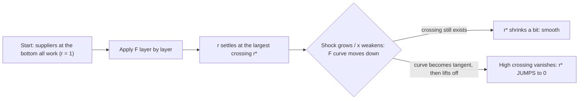
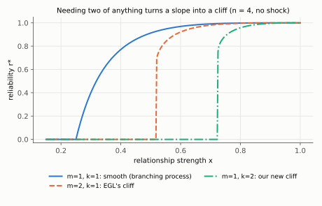
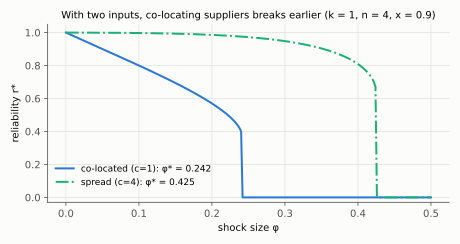
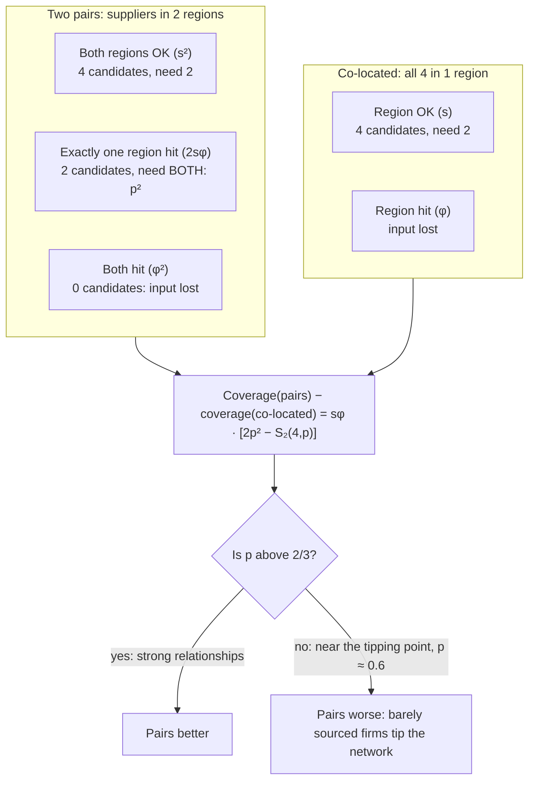
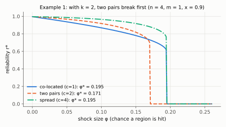
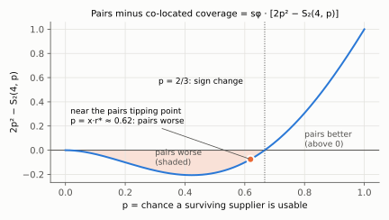
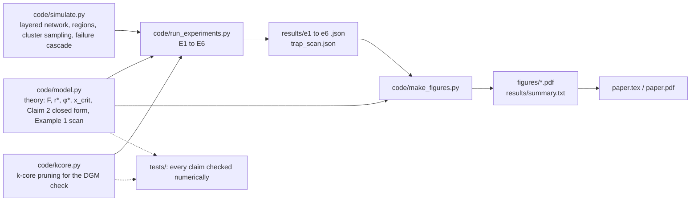

# Our work, explained

> **TL;DR:** We took EGL's supply-tree model and added two real-world features: firms need **k working suppliers** per input,
> and disasters knock out **whole regions**. Reliability is still the largest fixed point of one equation, so we proved four
> results about *when* collapse is sudden and *which* supplier geography is safest. Then we checked them on simulated
> networks of 420,000 firms.

Notation is in `05-cheatsheet.md`. The plots were computed from our own `code/model.py` by `tools/make_prep_figures.py`.

---

## The whole story in one picture

---

## 1. The model

**TL;DR:** EGL's layered supply tree, plus two changes: *k-of-n sourcing* and *regional shocks with c supplier clusters*.

**ELI5:** Every bakery needs *m* ingredients. For each ingredient it has *n* possible suppliers one layer down, and each deal
works with chance *x*. In EGL a bakery is fine if **one** supplier per ingredient comes through. In our version it needs **k** of them,
for example because one supplier can't deliver enough. Also, storms hit whole towns: when a town is hit, every bakery in it closes.
If a bakery's suppliers for an ingredient all live in the same town, one storm can wipe them all out at once.

**Exactly what we assume:**

| Piece | Meaning |
|---|---|
| Layers | Firms sit in layers of a deep tree; each buys from the layer below (EGL's setup). |
| m, n, x | m essential inputs, n potential suppliers per input, each relationship works with probability x. |
| **k-of-n** | An input is *covered* only if at least **k** of its n suppliers are *usable* (the supplier works **and** the relationship works). EGL is k = 1. |
| **Regional shock φ** | Each region is hit independently with probability φ, and a hit shuts down every firm in it. s = 1 − φ. |
| **Clusters c** | A firm's n suppliers for an input form c clusters of n/c. A cluster shares a region; different clusters are in different regions. With n = 4: **spread** c = 4, **pairs** c = 2, **co-located** c = 1. |

**One firm's survival check:**

**The equation (paper eq. 2):** let r be the chance that a firm works given that its own region survived. Then

> **r = F(r) = (P[an input is covered])^m**

The coverage probability depends on geography (S_k(N, p) = chance that at least k of N suppliers are usable):

| Geography | Coverage probability | Why |
|---|---|---|
| Spread (c = n) | S_k(n, s·x·r) | each supplier survives independently |
| Co-located (c = 1) | s · S_k(n, x·r) | all n survive together, or none do |
| Two pairs (n = 4) | s²·S_k(4, xr) + 2sφ·S_k(2, xr) | both pairs survive, or exactly one does |

**Reliability r\*** = the **largest** solution of r = F(r), as in EGL. The **tolerable shock φ\*** = the largest φ with r\* > 0.

**DGM link:** with m = 1 and spread suppliers, this equation has the same form as DGM's equation for the **(k+1)-core**. A core vertex
needs k neighbors besides the one it was reached from, just as our firm needs k suppliers. So we expected a jump once k ≥ 2.

---

## 2. Why a cliff can happen: the fixed point picture

**TL;DR:** Reliability is where the S-shaped curve F(r) crosses the diagonal. A bigger shock lowers the curve. The high crossing
disappears at a **tangency**, and reliability **jumps** to zero instead of sliding down.

**ELI5:** Imagine asking "if every supplier works with chance r, how likely am I to work?" The answer F(r) feeds back into the next
layer. The network settles where the answer equals the question. If the curve dips under the diagonal everywhere, the only
place left to settle is zero.

---

## 3. Claim 1: collapse is abrupt iff k·m ≥ 2

**TL;DR:** Needing **two of anything** (two inputs, or two suppliers for one input) creates a cliff. Only k = m = 1 fades gradually.

**ELI5:** If you need just one thing from one supplier, losing a little reliability costs a little. If you need two things, a small
drop in supplier reliability hits you twice. Below some point the feedback can't sustain *any* small positive reliability, so the
network has to jump from "pretty good" straight to "zero".

**What we showed (the proof idea, which you should be able to say out loud):**
- The chance that at least k suppliers are usable is at most C(n,k)·p^k (add up over every group of k suppliers).
- So F(r) ≤ K·r^(km) ≤ K·r² when km ≥ 2. For small r, F(r) < r: **no small positive fixed point exists**.
- Reliability is therefore either 0 or at least 1/K. Since it moves monotonically with x and φ, it must **jump**.
- If k = m = 1, then F(r) ≈ n·s·x·r for small r: a **branching process** with mean n·s·x (course §21.8), which grows continuously from 0.

**What's new:** for m ≥ 2 this is EGL's precipice. **m = 1 with k ≥ 2** is new: one input with two required suppliers is already enough for a cliff.

**How we checked it:** in simulations with no shock (validation, E1), the k = 2, m = 1 networks drop from about 0.74 to 0 at x ≈ 0.725, matching the theory.

---

## 4. Claim 2: spread versus co-located, in closed form

**TL;DR:** (a) Spreading suppliers out is *exactly* like weakening every relationship from x to (1−φ)x, so
**φ\*_spread = 1 − x_crit/x**. (b) **With one input, spread and co-located break at the same shock.** With m inputs,
**φ\*_co = 1 − (1 − φ\*_spread)^(1/m)**, which is smaller.

**ELI5:** Spread suppliers each get hit separately, which just looks like every deal being a bit less reliable. Co-located suppliers are
all-or-nothing. With one input those two kinds of risk balance out exactly at the breaking point. With several inputs, co-location
gives *each* input its own chance of being wiped out, so the firm is hit m times over.

**What we showed:** write G(u) = [S_k(n, x·u)]^m. Spread gives r = G(s·r); multiplying by s and setting u = s·r gives **u = s·G(u)**.
Co-located gives **r = s^m·G(r)**. Both are **u = a·G(u)**, with a = s for spread and a = s^m for co-located. A positive solution exists
exactly when a ≥ some cutoff a\* that depends only on G. When m = 1 the two constants are the same.

**Magnitudes to say in words:** for m = 2, n = 4, x = 0.9, co-location roughly **halves** the tolerable shock. Needing k = 2 instead of
k = 1 shrinks it **more than fivefold**.

---

## 5. Claim 3: with k = 1, splitting clusters never hurts

**TL;DR:** If one working supplier is enough, splitting each regional cluster into smaller ones (c → c′ with c dividing c′) never lowers reliability or the tolerable shock.

**ELI5:** If you only need one supplier, more separate "bets" is always better than fewer big bets.

**What we showed (Jensen's inequality):** with k = 1, an input fails only if *no* supplier is usable. Let q = 1 − x·r. A cluster of b
suppliers gives nothing with probability φ + s·q^b (it's hit, or it survives but all b fail). Splitting it into two halves replaces
that with (φ + s·q^(b/2))². Since y ↦ y² is convex, (φ·1 + s·t)² ≤ φ·1² + s·t² with t = q^(b/2). So each input fails less often, F goes up,
and so does its largest fixed point.

---

## 6. Example 1: with k = 2, two pairs can be the worst arrangement

**TL;DR:** With n = 4, k = 2, m = 1, x = 0.9: co-located and spread suppliers both break at **φ\* ≈ 0.195**, but **two regional pairs break
earlier, at ≈ 0.171**. Claim 3 does *not* extend to k ≥ 2.

**ELI5:** Losing one of your two towns doesn't kill you, but it leaves you with exactly the two suppliers you need, and both have to
come through. Near the breaking point, suppliers only come through about 60% of the time, so "both must work" is a bad bet. Co-located
firms are either untouched (four suppliers, plenty of slack) or wiped out. Near the edge, the "barely sourced" middle state is worse.

**Interesting detail in the plot:** for small shocks, pairs actually have *higher* reliability than co-located suppliers, yet they
**break first**. Safety in normal times and safety at the edge are different things.

**How general:** in a grid search (even n ≤ 8, m ≤ 3, six values of x), reversals like this appeared in **72 of the 109 settings with
k ≥ 2 where some geography tolerates a shock**, and in **none with k = 1**. The simulations also show a similar reversal for n = 6, k = 3.

**DGM link:** the barely sourced firms are like DGM's vertices with **exactly k core neighbors**. Remove one more and they fall out.

**Mechanism link (prior work):** coverage S_k is S-shaped (convex, then concave) in the number of surviving suppliers. Bimpikis–Fearing–Tahbaz-Salehi
get a similar backfire from S-shaped production. To our knowledge, ours is the first network-wide case where regional pairs are worst.

---

## 7. The simulations

**TL;DR:** The claims are about infinitely deep trees, so we built finite layered networks and checked every claim. Theory and simulation agree closely, and the simulations also answer Q3.

**Setup:** a bottom layer plus 20 layers above it, 20,000 firms each (420,000 total), placed in 200 regions. Mostly n = 4 and
x = 0.9 (above x_crit in every case, so collapse comes from the shock). Each firm picks random suppliers in the layer below following its
cluster pattern. Each run is compared with **20 steps** of the equation, evaluated at the share of regions *actually* hit in that run.

| Experiment (repo label) | Question | What we found (in words) |
|---|---|---|
| Validation (E1) | Do simulations match the equation? | Yes: over 3,360 runs the average gap from the 20-layer theory is tiny (about 0.0025). |
| Bimodality (E2) | **Q1**: is k = 2 really a cliff in finite networks? | At the predicted threshold, k = 1 runs all fade low; k = 2 runs **split into two groups**, collapsed or healthy. Which group a run lands in tracks how many regions happened to be hit. |
| Thresholds (E3, E5) | **Q2**: spread vs pairs vs co-located | Using 2,000 regions and bisection on the exact number hit, all 20 simulated thresholds sit right on the 20-layer theory. Co-location hurts with two inputs; **pairs break first** with one input and k = 2; similar reversal for n = 6, k = 3. |
| Hub regions (E4) | **Q3**: firm count vs supply share | Popular suppliers barely matter (about 0.03). But one region holding 11% of supply and only 0.5% of firms **collapses a k = 2 network on its own**, while 10 random regions (5% of firms) do so only rarely. The theory fits when the shock is measured as the share of **supplier clusters** hit. |
| k-core check (E6) | Is our pruning code right? | On 100,000-vertex random graphs, every k-core (k = 2 … 7) vanishes within about 0.01 of DGM's thresholds. |

**Why two theory columns in the table (infinite vs 20 layers)?** A finite network has less depth for failures to build up, so its
thresholds sit a bit *higher* than the infinite-depth ones. We compare simulations with the 20-layer theory, and they match it.

**From code to paper:**

---

## 8. What's new compared with prior work

| | One supplier enough? | Geography | Network | Main result |
|---|---|---|---|---|
| EGL 2022 | yes (k = 1) | none; independent failures | deep random tree | cliff when m ≥ 2; equilibrium near the cliff |
| CNST 2021 | backup suppliers absent from model | one real regional disaster | real Japanese firm network | smooth, fading spillovers |
| DGM 2006 | n/a: vertex needs k neighbors | random independent removal | random graphs | k-core jumps for k ≥ 3 |
| Papachristou et al. | yes | correlation parameter | percolation on supply networks | correlation lowers resilience → diversify geographically |
| Bimpikis et al. 2018 | dual sourcing | shared upstream suppliers | 3-tier chain | dual sourcing can backfire (S-shaped production) |
| **Ours** | **need k** | **explicit regions, c clusters** | **deep random tree** | **cliff iff k·m ≥ 2; closed form; pairs can be worst** |

---

## 9. Limitations and next steps (be ready to say these yourself)

- **Trees, not real networks:** no cycles, no hubs in the theory (we test hubs only in simulation).
- **Fixed geography:** firms don't *choose* k, n or c. **Next:** let firms choose how many suppliers and regions to use, at a cost, compute
  equilibria, and compare with a planner. We expect under-diversification and, with k = 2, sometimes pairs.
- **No data test yet.** **Next:** use OECD inter-country input–output tables (countries as regions) around the 2011 Thailand floods and check
  whether output losses **jump** once an industry's input share from the hit region passes some level.
- **Smaller open questions:** exactly when pairs are worst; what cycles change; protecting firms on a budget (a reverse influence maximization, as in Kempe–Kleinberg–Tardos).
