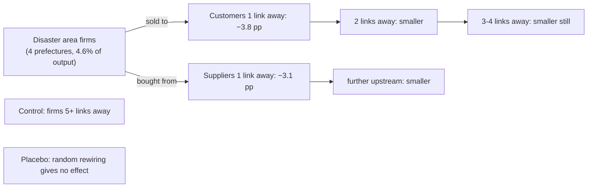

# CNST: Carvalho, Nirei, Saito & Tahbaz-Salehi (2021), "Supply Chain Disruptions: Evidence from the Great East Japan Earthquake"

*Quarterly Journal of Economics* 136(2), 1255–1321. The leading **empirical** study of shocks spreading through supply chains, and the shock it studies is regional.

> **TL;DR:** After the 2011 earthquake and tsunami, firms whose **suppliers** or **customers** were in the disaster area grew several percentage points
> more slowly than similar firms that weren't linked to it, and the effect **faded with each step away in the network**. A calibrated model says
> these network links roughly **doubled** the national GDP hit (0.47 pp of growth, versus 0.21 pp if links out of the region had been cut).

## ELI5

The tsunami hit a few prefectures holding only about 5% of Japan's output. On its own that should barely dent the national economy. But firms
elsewhere bought parts from, or sold to, firms in that area. Those firms slowed down too, and so did *their* partners, a little less each step
away. By comparing linked firms with unlinked look-alikes (difference-in-differences), the authors measure how far the damage traveled.

## What they did

| Piece | Their setup |
|---|---|
| Data | Proprietary Tokyo Shoko Research supplier–customer links. The panel has **750,237 firms**, about **5 suppliers** each, with heavy-tailed degrees. |
| Shock | March 2011 earthquake and tsunami. The four affected prefectures hold **4.6%** of output; their own losses account for only about **0.1 pp** of national growth. |
| Design | **Difference-in-differences**: sales growth of firms at network distance 1, 2, 3, 4 from disaster-area firms, against firms 5+ links away. |
| Robustness | A **placebo** network with randomly rewired links shows **no** effect. Tsunami-only definitions, single-plant firms and power-grid splits give consistent results. |
| Model | General equilibrium with nested CES production. Intermediates are **substitutable** with each other, and primary factors and intermediates are **complements**. |

## Key results

1. Firms with a **supplier** in the disaster area: **−3.8 pp** sales growth. With a **customer** there: **−3.1 pp**.
2. The effects **shrink with network distance**, but are still visible several links away.
3. The calibrated model attributes **0.47 pp** of lost GDP growth to the disaster, versus **0.21 pp** without links out of the region.

## How we used it, and how we differ

- **Motivation:** real disasters are **regional**, and supply links really do carry shocks. That motivates our regional-shock model.
- **Calibration hint:** firms have about **five suppliers**, so we mostly use **n = 4 per input**.
- **Hubs:** CNST's heavy-tailed degrees motivate our **hub-region** and **popular-supplier** simulations (Q3).
- **The puzzle we resolve:** CNST see **smooth** propagation, while EGL and we predict **cliffs**. These are **compatible** for three reasons:
  1. Their model uses smooth CES substitution and firms never shut down, so it **cannot produce a jump**.
  2. Their sample requires sales in **every year** 2010–2012, which would **exclude firms that exited**, the outcome most telling of collapse.
  3. Even in EGL's model, a network **far above its tipping point** absorbs shocks smoothly.

## Weaknesses we named (from our paper)

1. Production substitutes smoothly and firms never shut down, so output falls smoothly and **can't show a threshold**.
2. Exposure is **network distance** to the disaster area, which treats a firm with **1 of 10** suppliers there the same as one with **10 of 10**.
3. The sample requires sales every year, which would **drop exits**.

Our model suggests measuring exposure as the **share of a firm's suppliers for each input** in the hit region, and predicts a **sharp drop**
once fewer than k suppliers survive. CNST's data is proprietary, so our plan is a first **aggregate** test on public OECD inter-country
input–output tables around the **2011 Thailand floods** (countries as regions). Per-input exposure and exit would need firm-level data.

## Course connections

- A clean **causal** measurement of contagion on a real network.
- Their model spreads a shock through a **damped sum over supply paths**, like the walk sums behind **PageRank** (E–K §14.6).

## Questions staff might ask

- *Doesn't CNST's smooth evidence contradict your cliffs?* No. Their model can't make a jump, their sample drops exits, and a network far from its
  tipping point looks smooth anyway. Our model predicts **where** to look for a jump: firms left with fewer than k suppliers for some input.
- *How would you test your model with data like theirs?* Measure per-input supplier exposure, and look for a kink once fewer than k survive, plus more exits among the most exposed.
- *Why does the placebo matter?* It shows the effect travels along **actual** links, not just through geography or industry.
