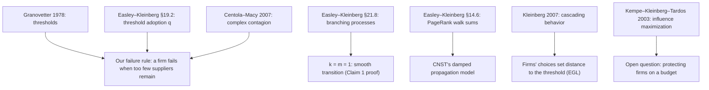

# Course references we cite

Short cards. Each one says what the work is, and **where it shows up in our paper** (the part staff care about).

---

### Granovetter (1978), "Threshold Models of Collective Behavior" (*AJS*)
- **TL;DR:** Each person joins (a riot, a fad) once enough others have joined. Their personal threshold decides when, and small changes in the threshold distribution can flip the outcome.
- **ELI5:** "I'll dance if at least three people are already dancing."
- **In our paper:** our failure rule is a threshold rule **in reverse**: a firm *drops out* when, for some input, fewer than k suppliers remain.

### Easley & Kleinberg (2010), *Networks, Crowds, and Markets*: §19.2 (networked coordination / threshold q)
- **TL;DR:** A node adopts a behavior once at least a fraction q of its neighbors have. This leads to cascades and to "blocking clusters".
- **In our paper:** the same threshold logic (cited next to Granovetter).

### Easley & Kleinberg §21.8 (branching processes, advanced material)
- **TL;DR:** In a branching process, each individual has a random number of children. The population survives forever with positive probability iff the mean is above 1, and that survival probability grows **continuously** from 0.
- **In our paper:** the **k = m = 1** case of our recursion *is* a branching process with mean n·s·x. That is why that case fades smoothly (Claim 1's second half).

### Easley & Kleinberg §14.6 (PageRank and random walks, advanced material)
- **TL;DR:** PageRank can be written as a damped sum over all walks in the link graph.
- **In our paper:** CNST's model spreads a shock through a **damped sum over supply paths**, the same structure.

### Centola & Macy (2007), "Complex Contagions and the Weakness of Long Ties" (*AJS*)
- **TL;DR:** Some behaviors need reinforcement from **several** contacts (complex contagion), not one (simple contagion). For those, long-range ties help less than clustered ones.
- **ELI5:** You catch a cold from one person, but you join a protest only if several friends go.
- **In our paper:** needing m ≥ 2 inputs (or k ≥ 2 suppliers) is like a complex contagion **of failure**: several things must go right, and that is what produces the cliff.

### Kleinberg (2007), "Cascading Behavior in Networks: Algorithmic and Economic Issues" (in *Algorithmic Game Theory*)
- **TL;DR:** A survey chapter on cascades: threshold and cascade models, when cascades spread, and the algorithmic and strategic questions around them.
- **In our paper:** the new element in EGL, *in this spirit*, is that **agents' own choices** (investment in relationships) set how close the network sits to its threshold.

### Kempe, Kleinberg & Tardos (2003), "Maximizing the Spread of Influence through a Social Network" (*KDD*)
- **TL;DR:** Choose k seed nodes to maximize the spread of a cascade. Under standard cascade models the spread function is **submodular**, so greedy selection is a (1 − 1/e)-approximation.
- **In our paper:** our open question, **protecting firms on a budget**, is a *reverse* influence-maximization problem (choose whom to protect so that the fewest fail).
