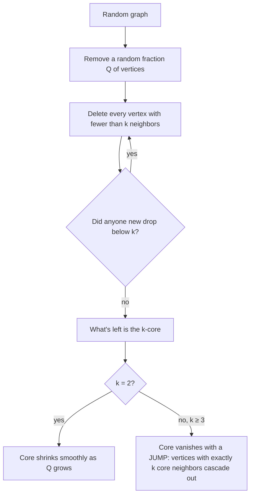

# DGM: Dorogovtsev, Goltsev & Mendes (2006), "k-Core Organization of Complex Networks"

*Physical Review Letters* 96, 040601. The **mathematical cousin** of our model: a structure that collapses **abruptly** under random damage.

> **TL;DR:** The k-core is what's left after you repeatedly delete every vertex with fewer than k neighbors. On random graphs, the k-core
> shrinks **smoothly** for k = 2, but for **k ≥ 3** it **vanishes with a jump** as vertices are randomly removed (a "hybrid" transition: a jump plus
> a square-root singularity). The same fixed-point math is behind our cliff.

## ELI5

Think of a friend group where you only stay if at least **k** of your friends stay. Remove a few people at random, and anyone left with too
few friends leaves too, which can make *their* friends leave. With k = 2 the group just thins out gradually. With k = 3 or more, it can look
fine and then **unravel all at once**: many members are hanging on with *exactly* k friends, so one more departure sets off an avalanche.

## What they did

| Piece | Their setup |
|---|---|
| Graphs | Random graphs with a given degree distribution (the **configuration model**). They look locally like **trees**, which allows a fixed-point analysis. |
| Damage | Remove a random fraction **Q = 1 − p** of vertices. |
| Method | Find the probability that following an edge leads into a big enough subtree. This gives a self-consistency (fixed-point) equation. For Erdős–Rényi graphs with mean degree z: **u = p·P[Poisson(z·u) ≥ k−1]**. |
| Core size | A vertex is in the k-core if at least k of its neighbors lead into such subtrees. |

## Key results

1. **k = 2:** the core shrinks **continuously**, like the giant component (ordinary percolation).
2. **k ≥ 3:** the core **jumps** to zero at a threshold, approached with a **square-root singularity**: a *hybrid* transition.
3. **Near the threshold**, clusters of core vertices with **exactly k** core neighbors grow very large; their mean size diverges. (The same
   authors later call this set the *corona*.)
4. **Example (Erdős–Rényi, mean degree 10):** the highest core disappears after only about **1.2%** of vertices are removed, while the
   ordinary giant component survives until about **90%** are gone. (Solving the equations ourselves, the **7-core** vanishes at **1.25%**.)
5. **Scale-free graphs** with 2 < γ ≤ 3 have an infinite sequence of k-cores that are **ultra-robust** to random damage.

## How we used it, and how we differ

- **Same math:** with **m = 1** and spread suppliers, our equation u = s·S_k(n, x·u) has the same form as DGM's **u = p·P[Poisson(z·u) ≥ K−1]**.
  Our **k** matches their **K = k + 1** core: a core vertex needs k neighbors besides the one it was reached from, just as our firm needs k suppliers.
- **Prediction:** so we **expected** a cliff once **k ≥ 2**, which Claim 1 proves (DGM's K ≥ 3 corresponds to our k ≥ 2).
- **Corona ↔ "barely sourced" firms:** in Example 1, firms that lose one regional pair are left with **exactly k** suppliers, like DGM's
  vertices with exactly k core neighbors. They are the ones that tip the network.
- **Our check of their result:** our own pruning code (`code/kcore.py`), run on simulated 100,000-vertex Erdős–Rényi graphs, finds every k-core
  (k = 2 … 7) vanishing within about **0.01** of the thresholds from DGM's equations. This checks our pruning code.

## Weaknesses we named (from our paper)

- **Mean-field:** it ignores short cycles and degree correlations.
- Damage is **random and independent**.
- **Every vertex has the same threshold**, and links are **undirected**.
- A supply-network version needs **directed** links, **firm-specific** thresholds, and **correlated** damage. Our model adds **directed links** and **correlated (regional) damage**.

## Course connections

- Uses the **configuration model** and **branching / tree** arguments from the Random Graphs part of the course.
- **Pruning a core is itself a threshold cascade**: a vertex "fails" when too few neighbors remain.

## Questions staff might ask

- *Why exactly is K = k + 1?* In a tree-like graph you reach a vertex through one edge. To stay in the K-core it needs K − 1 **other** neighbors
  that also stay. Our firm needs k suppliers **below** it, so k = K − 1.
- *Why does k = 2 behave differently from k ≥ 3?* For the 2-core, the equation is linear near zero (like a branching process) and the core grows from 0.
  For k ≥ 3, the right-hand side is at least quadratic near 0, so no small solution exists and the core must jump. That is the same argument as our Claim 1.
- *What's the "corona" and why do you mention it?* It's the set of core vertices hanging on with exactly k neighbors; it explains the avalanche. Our
  barely sourced firms play the same role in Example 1.
