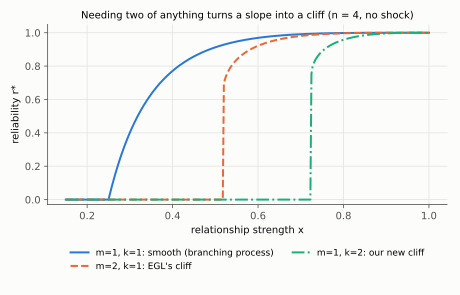
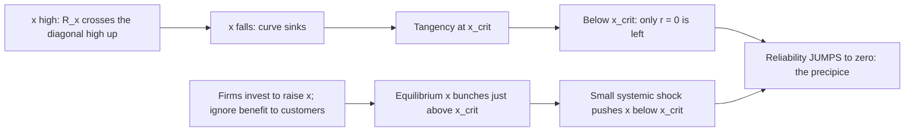

# EGL: Elliott, Golub & Leduc (2022), "Supply Network Formation and Fragility"

*American Economic Review* 112(8), 2701–2747. Our starting point and the model we extend.

> **TL;DR:** In a deep supply network where firms need several inputs, reliability doesn't decline smoothly. It falls off a
> **cliff** ("precipice") once supplier relationships get too weak. Worse, when firms pay to strengthen their own relationships,
> the market **settles right next to that cliff**, so a tiny shock can wipe out production. A planner would never choose that.

## ELI5

A car factory needs an engine **and** tires **and** glass. Each part has a few possible suppliers, and each supplier needs its own parts
from suppliers below it, and so on down the chain. If every deal is quite reliable, almost everything gets built. But as deals get
a little less reliable, failures compound across layers *and* across the parts you need. Past a certain point the whole chain
can't keep itself going, and output drops from "most things work" to "almost nothing works" all at once. Each firm only pays to
protect itself, not its customers, so firms tend to stop investing just short of safety, right on the edge.

## What they did

| Piece | Their setup |
|---|---|
| Network | Firms in **layers of a deep random tree**: each product needs **m** essential inputs, each with **n** potential suppliers in the layer below. |
| Failure | Each supplier relationship works independently with probability **x** (relationship strength). |
| Rule | A firm works if **every** input has **at least one** working relationship with a working supplier. |
| Reliability | R_x(r) = (1 − (1 − x·r)^n)^m. In a deep network, reliability is the **largest fixed point** of R_x. |
| Investment game | Each firm pays a cost to raise its own x. The paper compares the equilibrium with a social planner. |

## Key results

1. **Precipice (their Proposition 1):** for **m ≥ 2** (and n ≥ 2) there is a critical strength **x_crit**. Below it reliability is 0; just
   above it reliability is clearly positive, and the curve is nearly vertical there. For **m = 1** the drop is **continuous** (a branching process).
2. **Equilibrium bunches at the edge (their Theorem 1, proved for m ≥ 3):** for a whole range of investment costs, equilibrium strength
   sits within a hair of x_crit. Reliability is so steep there that each firm's best response lands on the steep part.
3. **Inefficiency:** a planner **never** puts the network near x_crit, because near the threshold the social value of investing a bit more is enormous.
4. **Fragility:** in that critical regime, a tiny drop in baseline relationship quality (a systemic shock) collapses production. Multisourcing
   protects against *independent* failures but not against *correlated* ones.

## How we used it, and how we differ

- **Same skeleton:** we keep the deep layered tree, m, n, x, and "reliability = largest fixed point".
- **Change 1, k-of-n sourcing:** EGL is the special case **k = 1**. We require **k** usable suppliers per input.
- **Change 2, regional shocks:** EGL's failures are independent, and their only aggregate shock is a uniform drop in x. We add disasters that hit
  **whole regions**, so co-located suppliers fail together.
- **Result link:** Claim 1 says the cliff appears iff **k·m ≥ 2**. That **generalizes** their Proposition 1 (m ≥ 2) and adds the new case **m = 1, k ≥ 2**.
- **Claim 2(a) uses their machinery directly:** spread suppliers turn a regional shock into an EGL-style weakening x → (1−φ)x, so φ\*_spread = 1 − x_crit/x.

## Weaknesses we named (from our paper)

1. Relationship failures are **independent**; the only aggregate shock is a uniform drop in x. Real disasters are regional. *(We fix this.)*
2. **One working supplier always suffices**, which ignores capacity limits. *(We fix this.)*
3. The tree has **no hubs or cycles**, the equilibrium theorem is **proved only for m ≥ 3**, and **x_crit can't be observed** in data. *(We test hubs in simulation.)*

## Course connections

- The failure rule is a **threshold rule** (Granovetter; Easley–Kleinberg §19.2), run in reverse: a firm drops out when, for some input, none of its suppliers remains.
- With **m = 1** the recursion is the survival probability of a **branching process** (E–K §21.8).
- With **m ≥ 2** it resembles a **complex contagion** (Centola–Macy): you need several things to go right.
- In the spirit of **Kleinberg (2007)**, firms' own choices set how close the network sits to its threshold.

## Questions staff might ask

- *Why does needing two inputs create a jump when one input doesn't?* With m = 1 the recursion is linear near 0 (a branching process), so reliability
  grows from 0 smoothly. With m ≥ 2, F(r) is roughly r² near 0, so there is no small positive fixed point and reliability must jump.
- *Why do firms end up near the cliff?* Reliability is extremely steep near x_crit, and firms don't internalize their customers' benefit, so best
  responses bunch there for a range of costs. A planner would invest more.
- *What would you test empirically?* The cliff itself: losses should jump once exposure crosses a threshold. That is our OECD / Thailand-floods plan.
