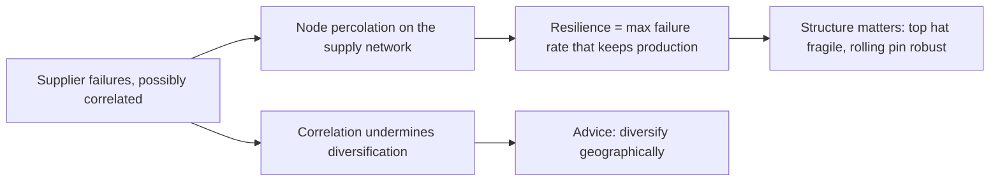
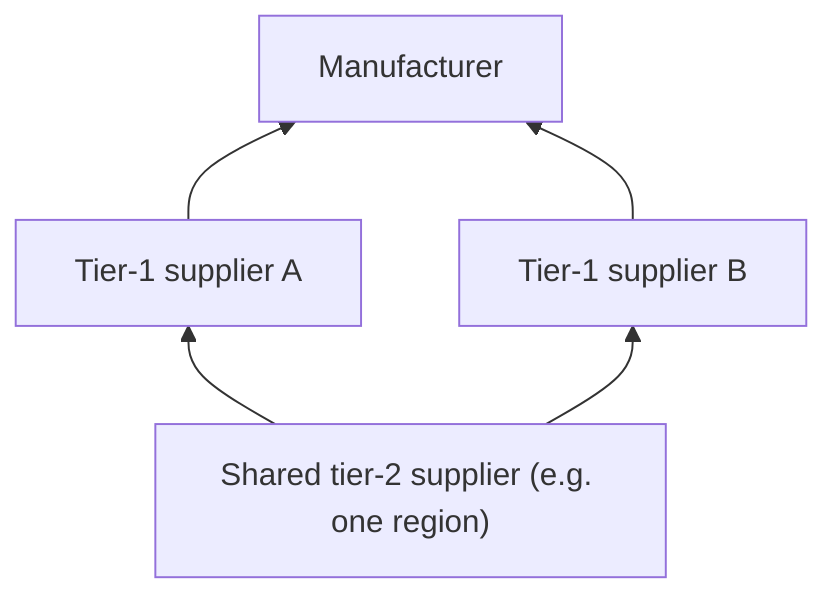
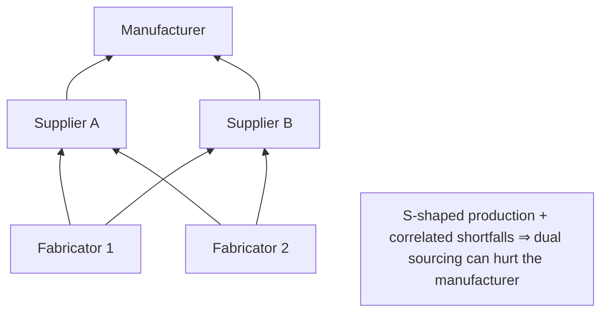

# Closest prior work (the "what's new?" papers)

These three papers are why we can say our contribution is new. Staff may ask "hasn't someone done this already?", and these are the answer.

| | Papachristou–Rahimian–Azadegan | Ang–Iancu–Swinney (2017) | Bimpikis–Fearing–Tahbaz-Salehi (2018) | **Ours** |
|---|---|---|---|---|
| Network | multi-tier supply networks; percolation | 3 tiers: manufacturer, tier 1, tier 2 | 3 tiers: manufacturer, 2 suppliers, 2 fabricators | deep random tree (EGL) |
| Sourcing rule | one surviving supplier per input suffices | multisourcing at tier 1 | single vs dual sourcing from tier 2 | **need k suppliers per input** |
| Geography / correlation | exogenous **failure correlation** (e.g. geographic) | **shared tier-2 suppliers** correlate tier-1 disruptions | dual sourcing **correlates** suppliers' outputs | **explicit regions, c clusters** |
| Headline | correlation undermines diversification → recommend geographic diversification | manufacturer always prefers less overlap; tier 1 may not | with **S-shaped** production, dual sourcing can hurt the manufacturer | cliff iff k·m ≥ 2; closed form; **regional pairs can be worst** |

**One-sentence positioning (memorize this one):**
> Papachristou et al. study supply cascades with percolation, but one supplier suffices and geography is just a correlation knob. The three-tier
> papers show that shared suppliers correlate failures and that dual sourcing can backfire with S-shaped production. We put **explicit regions into a full
> cascade**, solve the extremes in closed form, and show that needing k ≥ 2 suppliers alone creates the S-shape. By a mechanism like Bimpikis et al.'s,
> this gives, to our knowledge, the **first network-wide case where regional pairs are worst**.

---

## Papachristou, Rahimian & Azadegan, "Structural Measures of Resilience for Supply Chains" (arXiv 2303.12660, v4 2026)

> **TL;DR:** They define a network's **resilience** as the largest supplier failure rate it can sustain while keeping aggregate production. They compute
> it with **percolation and branching processes**, find which structures are fragile, and extend the analysis to **correlated** failures such as geographic ones.

**ELI5:** How many suppliers can randomly break before the factory output collapses? Some network shapes ("top hat": many raw materials, very
centralized) break easily; others ("rolling pin": controlled width, sparse) absorb shocks. If suppliers tend to fail together, diversifying helps less.

**How we differ:** in their model **one** surviving supplier per input is enough, and regions enter only as a **correlation parameter**. We model
**regions explicitly** and require **k** suppliers, and that is exactly when "spread across two regions" can backfire (Example 1).

---

## Ang, Iancu & Swinney (2017), "Disruption Risk and Optimal Sourcing in Multitier Supply Networks"

*Management Science* 63(8), 2397–2419.

> **TL;DR:** If two tier-1 suppliers secretly rely on the **same tier-2 supplier**, their disruptions coincide. The manufacturer then relies less on
> direct protection (inventory, multisourcing) and more on getting tier-1 suppliers to reduce their own risk. It always prefers less overlap, but
> tier-1 suppliers may prefer more, which creates a coordination problem that penalty contracts can ease.

**ELI5:** You buy from two bakeries to be safe, but both buy flour from the same mill. One mill fire and both bakeries fail. Your "backup" wasn't a backup.

**How we differ:** they analyze one small chain and contracts. We look at a **whole deep network** and ask which **geographic split** is safest when firms need k suppliers.

---

## Bimpikis, Fearing & Tahbaz-Salehi (2018), "Multisourcing and Miscoordination in Supply Chain Networks"

*Operations Research* 66(4), 1023–1039. **Closest mechanism to our Example 1.**

> **TL;DR:** Two tier-1 suppliers each decide whether to buy from one fabricator or split between two. Splitting (**dual sourcing**) lowers each supplier's
> own risk but **correlates** their shortfalls. If production is **S-shaped** (convex at low input, concave above), simultaneous shortfalls are very costly, so
> suppliers may **dual-source when the manufacturer would prefer they didn't**. Diversification can be excessive.

**ELI5:** Below a minimum amount of material a supplier can barely produce anything (the convex part). If everyone hedges the same way, everyone ends up
short at the same time, and that is worse for the buyer than some suppliers being fully fine and others fully out.

**How we relate:** our coverage probability S_k (need ≥ k of the surviving suppliers) is **S-shaped** in the number of survivors whenever **k ≥ 2**, with
no assumption about production. So the **same kind of backfire** appears, but at the level of a **whole cascading network**, and it is driven purely by the
**k-of-n requirement**. We credit them for the mechanism and claim the network-wide version.
